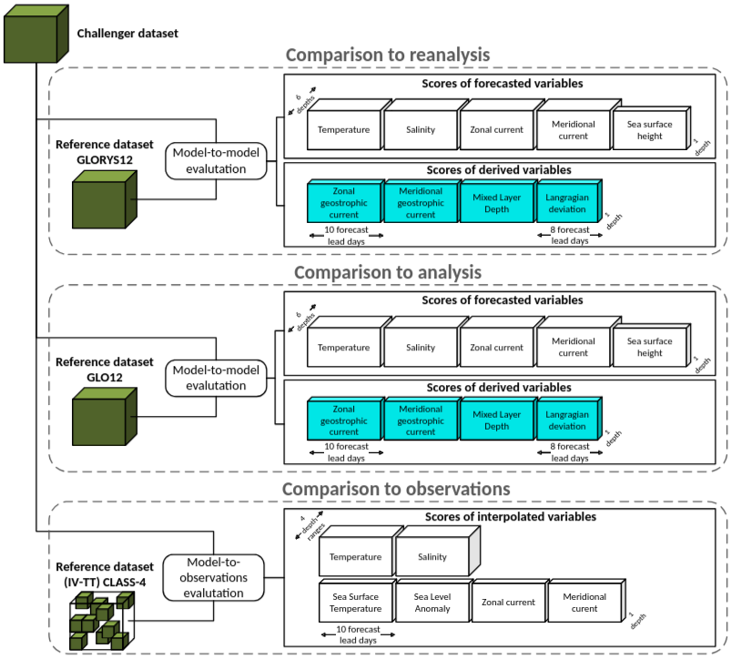

<!--
SPDX-FileCopyrightText: 2025 Mercator Ocean International <https://www.mercator-ocean.eu/>

SPDX-License-Identifier: EUPL-1.2
-->

---
title: "Definitions of evaluation methods"
---

Several methods are used to evaluate forecasting systems in OceanBench. Each of them is applied to a dataset grouping 52 weekly forecasts covering one year.

The following figure provides an overview of the evaluation methodology, illustrating the multifaceted evaluation strategy that captures different aspects of model performance. This includes (i) observation-based intercomparison, (ii) reference-model benchmarking, and (iii) process-oriented diagnostics derived from physically meaningful variables. Together, these components provide a holistic view of each model's ability to reproduce observed ocean dynamics, maintain internal physical consistency, and generalize beyond the training regime.

## Reference datasets

OceanBench evaluates challengers against the following reference datasets:

-   [2024 GLORYS reanalysis](https://data.marine.copernicus.eu/product/GLOBAL_MULTIYEAR_PHY_001_030)
-   [2024 GLO12 analysis](https://data.marine.copernicus.eu/product/GLOBAL_ANALYSISFORECAST_PHY_001_024)
-   2024 in situ and satellite observations from the Copernicus Marine Service, prepared as described in `helper_scripts/observations2024_v2/README.md`: [Argo profiles and surface drifters](https://data.marine.copernicus.eu/product/INSITU_GLO_PHY_UV_DISCRETE_NRT_013_048), [along-track altimetry](https://data.marine.copernicus.eu/product/SEALEVEL_GLO_PHY_L3_MY_008_062)

You can open and explore these datasets by using the [`oceanbench.datasets.reference`](/documentation/api/datasets/reference/index.qmd) module.

The OceanBench ocean mask says which cells of the twelfth of a degree grid are ocean. A cell is ocean when it is wet in both the GLO12 and GLORYS12 official static masks. The gridded scores use it, so they cover the same area whatever the reference. Class IV uses it to select its observations. The Lagrangian trajectories do not use it. It is defined at the six standard depths and at 643.57 m, the first level below 600 m.

For gridded RMSD metrics, OceanBench takes the `cos(latitude)` area-weighted mean of squared deviations over the scored cells, so each cell counts in proportion to its area, then averages the daily RMSD over forecast initialization days. A cell is scored when it is ocean in the ocean mask and both the challenger and the reference have a value there. On a challenger grid other than the twelfth of a degree one, each cell takes the nearest mask cell. `Missing fraction` gives, per variable and depth, the area-weighted share of ocean cells where the reference has a value and the challenger has none. It is averaged over initialization and lead days and does not change the RMSD.

## Comparison to observations {#evaluation-methods-observations}

### Root Mean Square Deviation (RMSD) of variables compared to observations

The [Root Mean Square Deviation (RMSD)](https://en.wikipedia.org/wiki/Root_mean_square_deviation) (Class IV) between the challenger dataset and the 2024 in situ and satellite observations, for the sea level anomaly, sea water potential temperature, sea water salinity, and the eastward and northward sea water velocity: [along-track altimetry](https://data.marine.copernicus.eu/product/SEALEVEL_GLO_PHY_L3_MY_008_062) for the sea level anomaly, and [Argo profiles and surface drifters](https://data.marine.copernicus.eu/product/INSITU_GLO_PHY_UV_DISCRETE_NRT_013_048) for the temperature, salinity and velocity.

Class IV scores follow the IV-TT CLASS-4 framework ([Hernandez et al., 2009](https://doi.org/10.5670/oceanog.2009.71), [Ryan et al., 2015](https://doi.org/10.1080/1755876X.2015.1022330), [Divakaran et al., 2015](https://doi.org/10.1080/1755876X.2015.1022333)): each forecast is compared with the observations at the observation time, position and depth, and the RMSD is reported per variable, depth bin and lead day. The observation selection and quality control applied when building the observation store are documented in `helper_scripts/observations2024_v2/README.md`. Temperature and salinity are scored in depth bins down to 600 m. A challenger whose deepest level is shallower than 600 m is still scored on the full range, with its deepest level standing in for the missing depths.

Class IV scores the same observations for every challenger, whatever its grid. An observation is kept only when the four quarter degree cells around it are entirely ocean in the ocean mask, at the first mask depth at or below it. This drops observations right at the coast, in narrow straits and below the mask seafloor.

`Observations` gives the number of these observations at the first lead day, and `Missing` how many of them the challenger has no value for; those are left out of the RMSD.

## Comparison to reanalysis {#evaluation-methods-reanalysis}

### Root Mean Square Deviation (RMSD) of variables compared to GLORYS reanalysis

The area-weighted (cos latitude) [Root Mean Square Deviation (RMSD)](https://en.wikipedia.org/wiki/Root_mean_square_deviation) between the challenger dataset and the [GLORYS reanalysis dataset](https://data.marine.copernicus.eu/product/GLOBAL_MULTIYEAR_PHY_001_030), i.e., over all dataset variables.

Only 6 depths are used:

-   Surface (\~0.49 meters)
-   50 m (\~47 meters)
-   100 m (\~92 meters)
-   200 m (\~223 meters)
-   300 m (\~318 meters)
-   500 m (\~541 meters)

### Root Mean Square Deviation (RMSD) of Mixed Layer Depth (MLD) compared to GLORYS reanalysis

The area-weighted (cos latitude) [Root Mean Square Deviation (RMSD)](https://en.wikipedia.org/wiki/Root_mean_square_deviation) between the two [Mixed Layer Depth (MLD)](https://en.wikipedia.org/wiki/Mixed_layer) computations over the challenger dataset and the [GLORYS reanalysis dataset](https://data.marine.copernicus.eu/product/GLOBAL_MULTIYEAR_PHY_001_030).

The mixed layer depth is computed in meters on each dataset\'s native vertical grid using depth levels up to 600 meters with a density threshold of 0.03 kg/m³. The reported value is one of the source depth levels, not an interpolated threshold-crossing depth. If the threshold is not reached within the capped profile, OceanBench reports the deepest finite level available within the cap; in deep-water columns, mixed layers deeper than 600 meters are therefore reported as 600 meters. This native-grid diagnostic preserves each system\'s represented vertical structure; vertical resolution therefore affects cross-challenger comparability.

### Root Mean Square Deviation (RMSD) of geostrophic currents compared to GLORYS reanalysis

The area-weighted (cos latitude) [Root Mean Square Deviation (RMSD)](https://en.wikipedia.org/wiki/Root_mean_square_deviation) between the two [geostrophic current](https://en.wikipedia.org/wiki/Geostrophic_current) computations over the challenger datasets and the [GLORYS reanalysis dataset](https://data.marine.copernicus.eu/product/GLOBAL_MULTIYEAR_PHY_001_030).

The geostrophic currents are computed using sea surface height above geoid with an Earth rotation rate of 7.2921e-5 s⁻¹, an Earth radius of 6371 km and a gravity of 9.81 m/s². Latitudes within 5° of the Equator are excluded, where the Coriolis parameter vanishes and altimetry products switch to an equatorial formulation ([Lagerloef et al., 1999](https://doi.org/10.1029/1999JC900197)).

### Deviation of Lagrangian trajectories compared to GLORYS reanalysis

The deviation in kilometers between the two sets of drifting particles computed over the challenger datasets and the [GLORYS reanalysis dataset](https://data.marine.copernicus.eu/product/GLOBAL_MULTIYEAR_PHY_001_030).

The particles are seeded by sampling ocean grid points without replacement using `cos(latitude)`-weighted probabilities, then simulated over the area.

The particles are released on the first forecast day, and lead day N is the mean separation on forecast day N, so the scores start at lead day 2.

### Marine heatwave diagnostics compared to GLORYS reanalysis

The detection skill and intensity error of [marine heatwaves](https://doi.org/10.1016/j.pocean.2015.12.014) (MHW) in the challenger sea surface temperature, compared to the [GLORYS reanalysis dataset](https://data.marine.copernicus.eu/product/GLOBAL_MULTIYEAR_PHY_001_030). They tell whether a forecast predicts the extreme warm events seen in the reference, and how warm they are.

A MHW is detected following [Hobday et al., 2016](https://doi.org/10.1016/j.pocean.2015.12.014): the temperature at the surface level (\~0.49 meters) exceeds the daily 90th percentile of the 1993–2022 GLORYS12 climatology for at least 5 consecutive days, and events separated by at most 2 days below the threshold are joined into one. The same climatology and the same detection are applied to the challenger and the reference, so they are judged against the same threshold. The climatology day of the year is taken on a 366-day calendar, so a calendar day always uses the same threshold. A missing temperature is not filled: it counts as a day below the threshold, so it interrupts a run of warm days but can lie in a gap of at most 2 days joining two events. Climatologies are available on the quarter degree and twelfth of a degree grids; on the one degree grid, the metric returns a message instead of scores.

A forecast of 10 days is too short to see a whole event: an event already in progress at initialization would look like a new, shorter one. The 7 days before each forecast initialization are therefore prepended before the detection, taken from the GLO12 analysis for the challenger, as the state a forecast starts from, and from the GLORYS reanalysis for the reference, so that the reference stays a single product. They are only used for the detection and are not scored. When they are not available, as before the first 2024 initialization, the forecast is detected without them. At the other end, events starting in the last 4 lead days cannot last 5 days within the forecast and are not detected, in both the challenger and the reference.

The probability of detection (POD, share of reference MHW days also predicted by the challenger), false alarm ratio (FAR, share of predicted MHW days absent from the reference) and critical success index (CSI, hits over hits, misses and false alarms) are computed per lead day from the `cos(latitude)` area-weighted counts over all initializations and grid cells. A score whose denominator is zero is reported as missing. The intensity is the temperature minus the climatological mean on MHW days, and zero elsewhere; its RMSE is computed per lead day over all initializations and grid cells where the challenger or the reference is in a MHW, so that both missed and false events are penalized. Only cells and days where the challenger, the reference and the climatology all have a value are scored, instead of using the ocean mask: a challenger is neither rewarded nor penalized where it gives no forecast.

## Comparison to analysis {#evaluation-methods-analysis}

### Root Mean Square Deviation (RMSD) of variables compared to GLO12 analysis

The area-weighted (cos latitude) [Root Mean Square Deviation (RMSD)](https://en.wikipedia.org/wiki/Root_mean_square_deviation) between the challenger dataset and the [GLO12 analysis dataset](https://data.marine.copernicus.eu/product/GLOBAL_ANALYSISFORECAST_PHY_001_024), i.e., over all dataset variables.

Only 6 depths are used:

-   Surface (\~0.49 meters)
-   50 m (\~47 meters)
-   100 m (\~92 meters)
-   200 m (\~223 meters)
-   300 m (\~318 meters)
-   500 m (\~541 meters)

### Root Mean Square Deviation (RMSD) of Mixed Layer Depth (MLD) compared to GLO12 analysis

The area-weighted (cos latitude) [Root Mean Square Deviation (RMSD)](https://en.wikipedia.org/wiki/Root_mean_square_deviation) between the two [Mixed Layer Depth (MLD)](https://en.wikipedia.org/wiki/Mixed_layer) computations over the challenger dataset and the [GLO12 analysis dataset](https://data.marine.copernicus.eu/product/GLOBAL_ANALYSISFORECAST_PHY_001_024).

The mixed layer depth is computed in meters on each dataset\'s native vertical grid using depth levels up to 600 meters with a density threshold of 0.03 kg/m³. The reported value is one of the source depth levels, not an interpolated threshold-crossing depth. If the threshold is not reached within the capped profile, OceanBench reports the deepest finite level available within the cap; in deep-water columns, mixed layers deeper than 600 meters are therefore reported as 600 meters. This native-grid diagnostic preserves each system\'s represented vertical structure; vertical resolution therefore affects cross-challenger comparability.

### Root Mean Square Deviation (RMSD) of geostrophic currents compared to GLO12 analysis

The area-weighted (cos latitude) [Root Mean Square Deviation (RMSD)](https://en.wikipedia.org/wiki/Root_mean_square_deviation) between the two [geostrophic current](https://en.wikipedia.org/wiki/Geostrophic_current) computations over the challenger datasets and the [GLO12 analysis dataset](https://data.marine.copernicus.eu/product/GLOBAL_ANALYSISFORECAST_PHY_001_024).

The geostrophic currents are computed using sea surface height above geoid with an Earth rotation rate of 7.2921e-5 s⁻¹, an Earth radius of 6371 km and a gravity of 9.81 m/s². Latitudes within 5° of the Equator are excluded, where the Coriolis parameter vanishes and altimetry products switch to an equatorial formulation ([Lagerloef et al., 1999](https://doi.org/10.1029/1999JC900197)).

### Deviation of Lagrangian trajectories compared to GLO12 analysis

The deviation in kilometers between the two sets of drifting particles computed over the challenger datasets and the [GLO12 analysis dataset](https://data.marine.copernicus.eu/product/GLOBAL_ANALYSISFORECAST_PHY_001_024).

The particles are seeded by sampling ocean grid points without replacement using `cos(latitude)`-weighted probabilities, then simulated over the area.

The particles are released on the first forecast day, and lead day N is the mean separation on forecast day N, so the scores start at lead day 2.

### Marine heatwave diagnostics compared to GLO12 analysis

The detection skill and intensity error of [marine heatwaves](https://doi.org/10.1016/j.pocean.2015.12.014) (MHW) in the challenger sea surface temperature, compared to the [GLO12 analysis dataset](https://data.marine.copernicus.eu/product/GLOBAL_ANALYSISFORECAST_PHY_001_024). They tell whether a forecast predicts the extreme warm events seen in the reference, and how warm they are.

A MHW is detected following [Hobday et al., 2016](https://doi.org/10.1016/j.pocean.2015.12.014): the temperature at the surface level (\~0.49 meters) exceeds the daily 90th percentile of the 1993–2022 GLORYS12 climatology for at least 5 consecutive days, and events separated by at most 2 days below the threshold are joined into one. The same climatology and the same detection are applied to the challenger and the reference, so they are judged against the same threshold. The climatology day of the year is taken on a 366-day calendar, so a calendar day always uses the same threshold. A missing temperature is not filled: it counts as a day below the threshold, so it interrupts a run of warm days but can lie in a gap of at most 2 days joining two events. Climatologies are available on the quarter degree and twelfth of a degree grids; on the one degree grid, the metric returns a message instead of scores.

A forecast of 10 days is too short to see a whole event: an event already in progress at initialization would look like a new, shorter one. The 7 days before each forecast initialization are therefore prepended before the detection, taken from the GLO12 analysis for both the challenger and the reference. They are only used for the detection and are not scored. When they are not available, as before the first 2024 initialization, the forecast is detected without them. At the other end, events starting in the last 4 lead days cannot last 5 days within the forecast and are not detected, in both the challenger and the reference.

The probability of detection (POD, share of reference MHW days also predicted by the challenger), false alarm ratio (FAR, share of predicted MHW days absent from the reference) and critical success index (CSI, hits over hits, misses and false alarms) are computed per lead day from the `cos(latitude)` area-weighted counts over all initializations and grid cells. A score whose denominator is zero is reported as missing. The intensity is the temperature minus the climatological mean on MHW days, and zero elsewhere; its RMSE is computed per lead day over all initializations and grid cells where the challenger or the reference is in a MHW, so that both missed and false events are penalized. Only cells and days where the challenger, the reference and the climatology all have a value are scored, instead of using the ocean mask: a challenger is neither rewarded nor penalized where it gives no forecast.
