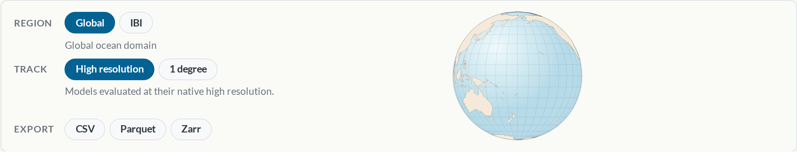
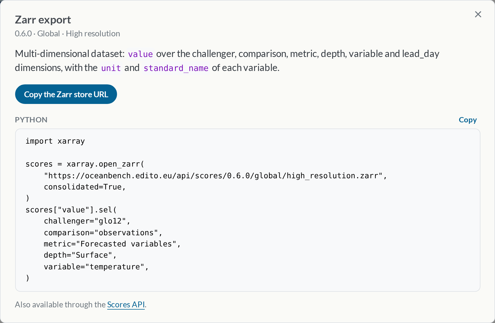

<!--
SPDX-FileCopyrightText: 2025 Mercator Ocean International <https://www.mercator-ocean.eu/>

SPDX-License-Identifier: EUPL-1.2
-->

The scores displayed on the [Scores page](/index.qmd) can now be downloaded, for every published OceanBench version, region and track.

## Export the displayed scores

An **Export** row sits next to the **Region** and **Track** pickers.



Each button opens a popup for the selected version, region and track, with:

- a button to download the file, or to copy the Zarr store URL,
- code snippets to open the scores in Python or download them from a shell,
- for CSV and Parquet, a link to explore the scores in the [EDITO Data Explorer](https://datalab.dive.edito.eu/data-explorer), without installing anything.



## Three formats

- **CSV** and **Parquet** hold one row per challenger, comparison, metric, depth, variable and lead day, ready for `pandas` or a spreadsheet.
- **Zarr** holds a multi-dimensional dataset: `value` over the `challenger`, `comparison`, `metric`, `depth`, `variable` and `lead_day` dimensions, with the `unit` and `standard_name` of each variable. Select any slice with `xarray`:

``` python
import xarray

scores = xarray.open_zarr(
    "https://oceanbench.edito.eu/api/scores/<version>/global/high_resolution.zarr",
    consolidated=True,
)
scores["value"].sel(challenger="glonet", comparison="reanalysis", depth="Surface")
```

## The Scores API

The same files are served at stable URLs, so scripts and pipelines can fetch them directly:

``` bash
curl https://oceanbench.edito.eu/api/scores/index.json
curl -O https://oceanbench.edito.eu/api/scores/<version>/<region>/<track>.parquet
```

`index.json` lists every available version, region and track.
The [Scores API documentation](/documentation/scores-api/index.qmd) describes the endpoints, columns and dimensions.
