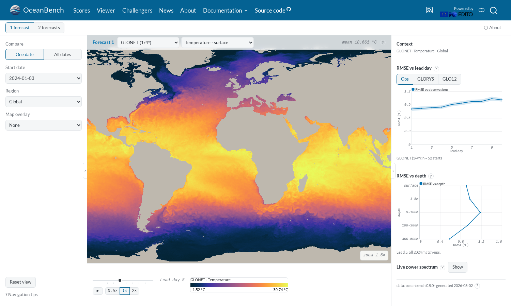
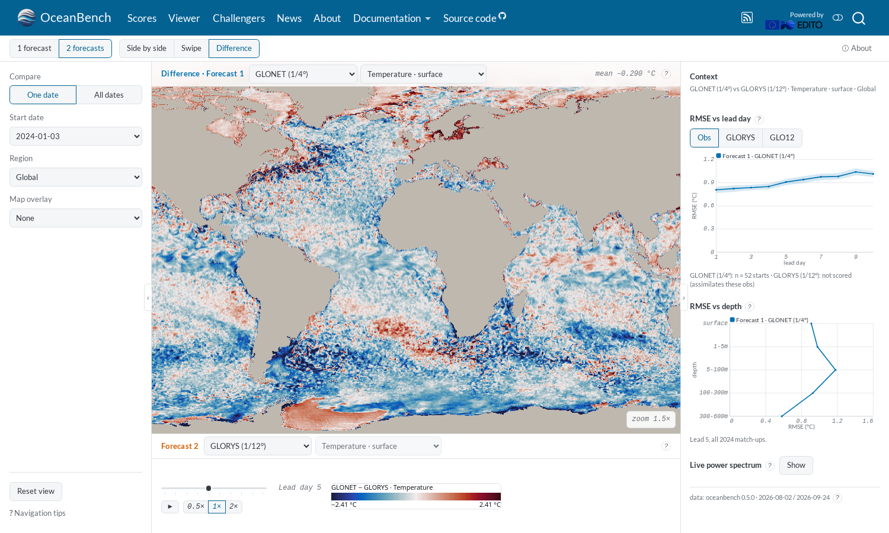
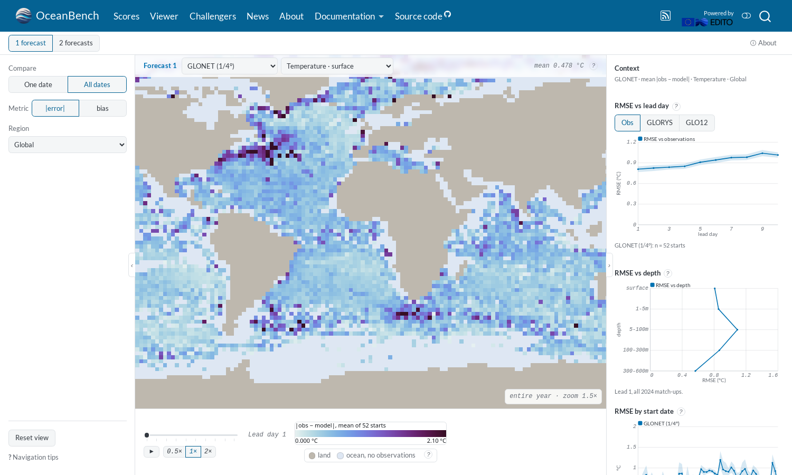

<!--
SPDX-FileCopyrightText: 2026 Mercator Ocean International <https://www.mercator-ocean.eu/>

SPDX-License-Identifier: EUPL-1.2
-->

## The Viewer

The [Viewer](/viewer.html) shows the forecast maps of the challengers.
Pick a system, a variable, a start date and a lead day. Compare two systems side by side, with a swipe or as a difference. Draw the Class IV observations, the detected eddies, the surface currents and the trajectories, click a point for its water column, and read the error statistics of the whole year.
Every view is saved in the URL, so a link reopens it.



Compare two systems side by side, with a swipe, or as a difference, for example GLONET minus GLORYS:



Switch to the whole year to see where a system is wrong on average against the observations:



The score tables link to the Viewer: each system and Class IV cell with data in the Viewer links to it.

The Viewer computes no score. It displays files prepared by the evaluation, so it shows the same numbers as the scores.

## Evaluation without notebooks

`oceanbench evaluate` and `oceanbench.evaluate_challenger` no longer generate and execute a notebook.
They run the challenger file, print every score table and write a [scores file](/documentation/scores-file/index.qmd), `<challenger>.<region>.scores.json`, with one row per score.
The `jupyter` and `papermill` dependencies are gone.

Scores are unchanged. The website reads the scores files of the versions that publish them, and the report notebooks of versions 0.1.0 to 0.6.0.

## Build the Viewer data of your system

Give `oceanbench evaluate` a directory to also write the Viewer data: maps, water columns, Class IV match-ups, eddies and score summaries.

``` bash
oceanbench evaluate challenger.py --viewer-artifacts-dir viewer-data
```

See [Building the viewer data](/documentation/viewer-data/index.qmd) for the files and their cost.
