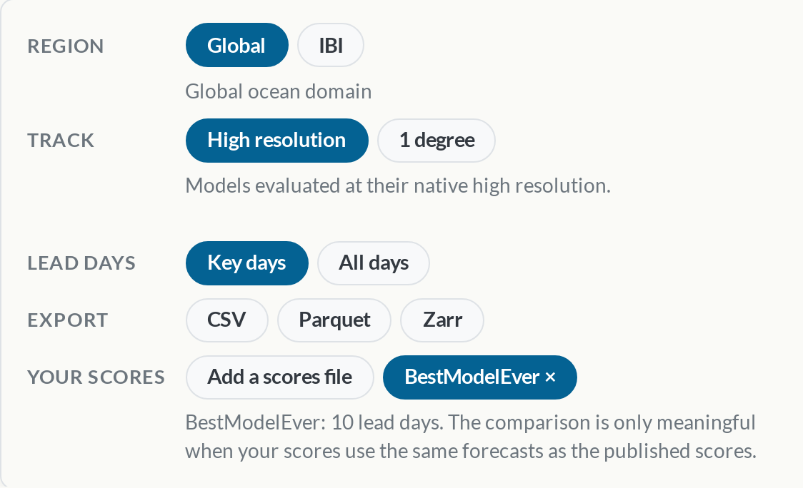
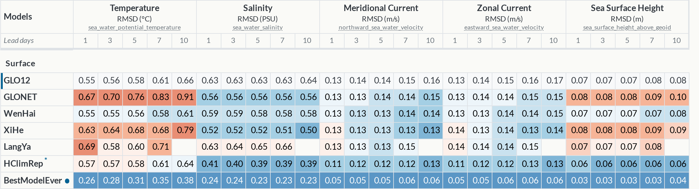
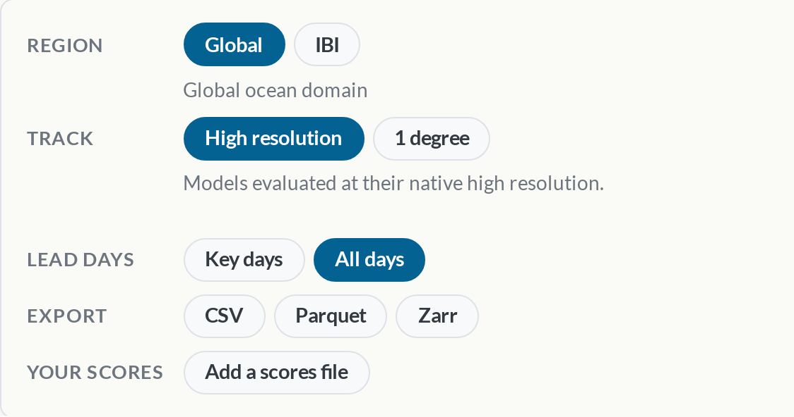

<!--
SPDX-FileCopyrightText: 2026 Mercator Ocean International <https://www.mercator-ocean.eu/>

SPDX-License-Identifier: EUPL-1.2
-->

`oceanbench evaluate` writes the scores of your system in a scores file.
You can now see it on the [Scores page](/index.qmd), as an extra row of the score tables, next to the published scores.

## Add a scores file

In the **Your scores** row, click **Add a scores file**, then choose one or several files on your computer, or give a public URL, for example on S3. You can add up to 5 systems, each as its own row.

The file is read in your browser and is never uploaded.
Your system appears in the tables with a blue circle marker, coloured like the other systems, as the difference to the selected baseline.

## Try it

[Open the Scores page with BestModelEver](/?scores=/news/posts/your-scores-on-the-website/BestModelEver.global.scores.json), a fake system that beats every other system, or download [its scores file](BestModelEver.global.scores.json) and add it yourself.

## Show every lead day

The tables show the key lead days (1, 3, 5, 7 and 10) by default.
In the **Lead days** row, click **All days** to show all 10 lead days, for the published scores and for yours.
The choice is kept in the page URL as `?lead_days=all`.

## Share the view

Open the Scores page with `?scores=<URL of the file>` to share it, for example `https://oceanbench.edito.eu/?scores=https://my-bucket.example.org/challenger.global.scores.json`. Repeat the parameter for each file, up to 5.
`oceanbench evaluate` prints this link when the scores file was uploaded with `--output-bucket`.
The bucket must be publicly readable and allow cross-origin reads.

## What to expect

- The file is shown next to the published scores of its region. The compared version is selected automatically by default, and you can force it manually with **Compare with** in the dialog or `?compare_with=<version>` in the page URL.
- Scores are only comparable when the forecasts are the same. The page reminds you of it under the row.
- Only the scores the website already shows are displayed.
