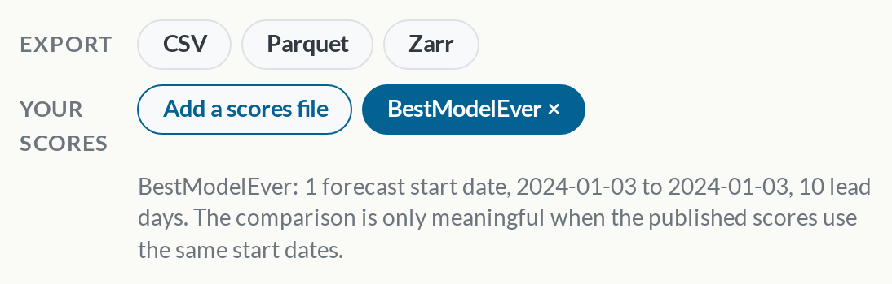
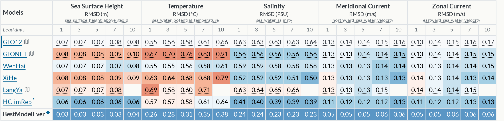

<!--
SPDX-FileCopyrightText: 2026 Mercator Ocean International <https://www.mercator-ocean.eu/>

SPDX-License-Identifier: EUPL-1.2
-->

`oceanbench evaluate` writes the scores of your system in a [scores file](/documentation/scores-file/index.qmd).
You can now see it on the [Scores page](/index.qmd), as an extra row of the score tables, next to the published scores.

## Add a scores file

In the **Your scores** row, click **Add a scores file**, then choose the file on your computer or give its public URL, for example on S3.

The file is read in your browser and is never uploaded.
Your system appears in the tables with a ◆ marker, coloured like the other systems, as the difference to the selected baseline.

## Try it

[Open the Scores page with BestModelEver](/?scores=/news/posts/your-scores-on-the-website/BestModelEver.global.scores.json), a fake system that beats every other system, or download [its scores file](BestModelEver.global.scores.json) and add it yourself.

## Share the view

Open the Scores page with `?scores=<URL of the file>` to share it, for example `https://oceanbench.edito.eu/?scores=https://my-bucket.example.org/challenger.global.scores.json`.
`oceanbench evaluate` prints this link when the scores file was uploaded with `--output-bucket`.
The bucket must be publicly readable and allow cross-origin reads.

## What to expect

- The file is shown next to the published scores of its OceanBench version and region. A version or region without published scores is rejected, and so is a file written with an unknown [schema version](/documentation/scores-file/index.qmd#schema).
- Scores are only comparable when the forecast start dates are the same. The page prints the start dates of your file under the row.
- Only the scores the website already shows are displayed.
